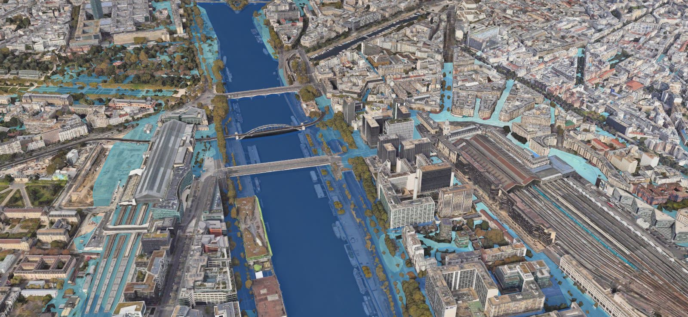
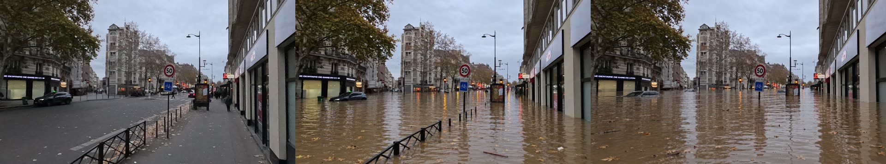
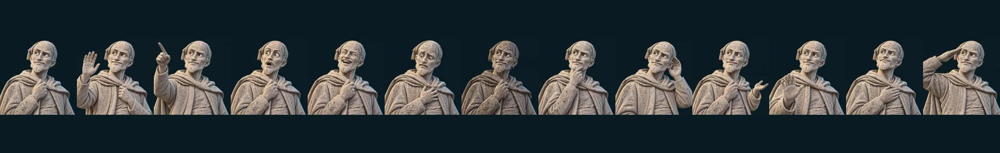
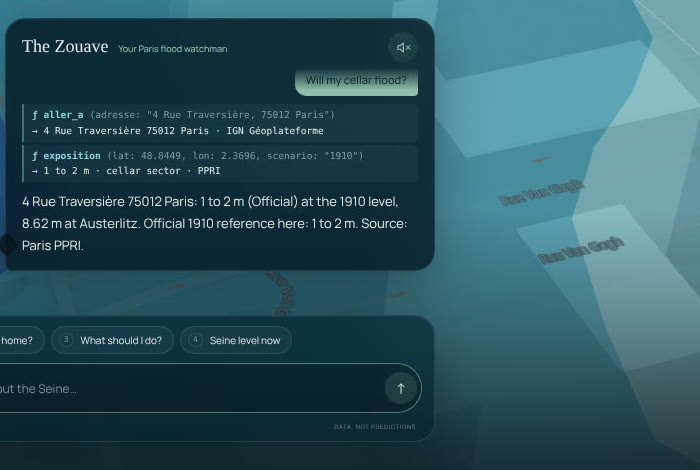

# Zouave · see your flood before it comes



**Zouave** shows any Parisian what a major Seine flood would mean for their own street, using official data only.
The guide is the Zouave of the Pont de l'Alma: the stone soldier on whom Parisians have read the Seine's floods for
generations. In January 1910, the water reached his shoulders. Now he talks.

▶ **[Watch the 2-minute video](video/zouave-pitch.mp4)** · built for the Paris DevDay Community Hackathon
(Impact → Climate action) · the interface is in English, and the data is French open data.

The website: https://zouave.vercel.app/
---

## Why

In January 1910 the Seine rose to **8.62 m** on the Austerlitz gauge, and Paris flooded for weeks. If it happened
today, up to **5 million people** would be affected and up to **€30 billion** of direct damage would follow
([OECD](https://www.oecd.org/fr/publications/mieux-prevenir-les-inondations-de-la-seine-en-ile-de-france_9789264290082-fr)).

Most Parisians have no idea what that would mean for their own building. Flood maps exist, but they are technical,
and nobody prepares for a risk they cannot picture. Zouave turns those maps into an answer you can see and hear for
your own address, and tells you what to do.

## What you can do

| | |
| --- | --- |
| **Ask about your address** | Type an address, or say "What about my home?". The Zouave flies to it, reads the official flood plan (PPRI) for the reference flood and tells you the expected depth class: *0 to 1 m*, *1 to 2 m* or *over 2 m*. He also says whether the address is in a cellar sector exposed in 1910 and, in the extreme scenario, whether it falls inside its footprint. |
| **Watch the Seine rise** | Drag the time slider through historic floods, from 1658 to today's live reading of the Austerlitz gauge. The water climbs in 3D, and counters show how many buildings and km² of Paris are under water at each level. |
| **See your street under water** | "Show my street flooded" turns a real street photo of the address into a 3D scene: a depth model lifts the photo into relief, and simulated water rises to the estimated height. A slider lets you set the water yourself. |
| **Know what to do** | "What should I do?" gives the official right moves (refuge, cellar, children, authorities), adapted to your household, each with its source. |
| **Talk to him** | Click the microphone and speak, or type. Every answer shows the tools the Zouave called and the figures they returned. He never invents a number. |
| **Watch the story** | Press **D** for a 90-second guided tour: today's level, 2016, 1955, 1910, your street, then what to do. |
| **Ask about anywhere** | Click any point of the map, then **What about here?**. |
| **Photorealistic Paris** | Press **G** to switch to Google Photorealistic 3D: the real city under the official water. The Story uses it automatically when the key is configured, and falls back to the map if it does not load. |
| **Try it on your phone** | **Under the hood** (key **U**) shows a QR code that opens Zouave on a phone on the same network. |


<sub>4 rue Traversière, 75012 Paris: today, then at 0.5 m and 1.5 m (the official class here is 1 to 2 m). These are simulations made with OpenAI image edits of a Panoramax photo (Lejun, CC BY-SA 4.0), not forecasts.</sub>

### A guide with a personality

The Zouave speaks English with a French accent and reacts to what you ask. He leans towards your pointer, looks
worried when the water reaches your door, is soaked when it goes over 2 m, points at the live gauge and salutes when you leave.
Poke him and he answers back. His 13 poses were generated with OpenAI image edits of the statue.



### Shortcuts

| Key | Action |
| --- | --- |
| **1** to **4** | Show me 1910 · What about my home? · What should I do? · Seine level now |
| **D** | Story mode (**Space** pauses, **→** skips a step, **Esc** quits) |
| **G** | Switch between the map and Google Photorealistic 3D |
| **H** | Immersion: hide the panels and let the camera drift over the city |
| **U** | Under the hood: how it works, with the QR code for phones |

## Can I trust it?



- **Official data only.** Depths come from the Paris flood risk plan (PPRI, Préfecture de Police / DRIEAT), buildings
  from IGN BD TOPO, the live level from Hub'Eau / Vigicrues, cellars from the City of Paris, the extreme footprint from
  the Institut Paris Région (SDRIF-E), and advice from Géorisques, the City of Paris and the Préfecture de Police.
- **Every figure carries a label.** *Measured* is a live sensor reading. *Official* comes from a published dataset.
  *Estimated* is computed by Zouave from official data, such as a level between two official classes.
- **No invented numbers.** The voice agent can only answer with what its tools return, and each answer lists those
  tool calls.
- **Simulations, not forecasts.** The street scenes and the AI-edited photos show a plausible water height. They are
  not a survey of your building, and being outside a zone does not rule out risk or utility outages.

<br clear="right">

## Run it

You need Node 22.6 or later and npm.

```sh
npm ci
npm start          # type-check, build, then one server on http://localhost:3000
npm run dev        # development: Vite on 5173, Express on 3000
npm test           # unit and HTTP tests, no paid API calls
```

Browser checks and the (billable) voice smoke tests are described in
[`data/APP_VERIFICATION.md`](data/APP_VERIFICATION.md).

Everything works without any key: the map, the timeline, addresses, exposure, the street scene, the advice, the Story
and the browser's own voice. Keys add the rest. Put them in a `.env` file at the root (it is gitignored); never paste
them in a chat. [`docs/SETUP.md`](docs/SETUP.md) explains how to get each key and how to set up network access.

| Variable | Unlocks |
| --- | --- |
| `OPENAI_API_KEY` | The voice agent (OpenAI Realtime with function calling), and a narrated voice if there is no ElevenLabs key |
| `ELEVENLABS_API_KEY` | The Zouave's narrated voice, English with a French accent |
| `GOOGLE_MAPS_API_KEY` | Google Photorealistic 3D (Map Tiles API, proxied by the server; the key never reaches the browser) |
| `GOOGLE_MAPS_BROWSER_KEY` | Street View in the browser (restrict it to your site) |

<details>
<summary>All settings</summary>

| Variable | Default | Purpose |
| --- | --- | --- |
| `ZOUAVE_VOICE` | `live` | `live` or `realtime` |
| `ZOUAVE_REALTIME_MODEL` | `gpt-realtime-2.1` | Set `gpt-realtime` if the newer model is unavailable |
| `ZOUAVE_ELEVEN_VOICE` | `K8nDX2f6wjv6bCh5UeZi` | ElevenLabs voice ("Jamie - French Accent & Charismatic", shared library) |
| `ZOUAVE_ELEVEN_MODEL` | `eleven_multilingual_v2` | ElevenLabs model for answers (fast) |
| `ZOUAVE_ELEVEN_EXPRESSIVE_MODEL` | `eleven_v3` | ElevenLabs model for the Story narration (audio tags such as `[excited]`) |
| `ZOUAVE_TTS` | on with a key | `off` disables the narrated voice (`/api/tts`) |
| `ZOUAVE_TTS_MODEL` | `gpt-4o-mini-tts` | OpenAI text-to-speech model, used when there is no ElevenLabs key |
| `ZOUAVE_TTS_VOICE` | `marin` | OpenAI voice name |
| `ZOUAVE_HTTPS` / `HTTPS_PORT` | off / `3443` | Self-signed HTTPS listener so phones can use the microphone (QR code) |
| `ZOUAVE_PUBLIC_URL` | LAN address | URL encoded in the "try it on your phone" QR code |
| `PORT` | `3000` | Server port |

Narrated lines are cached in `.cache/tts/`, so a line spoken once replays offline. Voice sessions are billed with a
minimum charge, so click the microphone only when needed; idle sessions close after two minutes. Add `?google=0` to the URL to keep
the Story on the map, and `?avatar=stone` or `?avatar=bronze-flood` to change the statue.
</details>

## How it works

```
You (voice or text) ──► the Zouave agent ──► tools in your browser ──► official open data
                        OpenAI Realtime       aller_a · exposition       PPRI · IGN · Hub'Eau
                        function calling      niveau_seine · consignes   City of Paris · SDRIF-E
                                              afficher_crue · …          Géorisques · Préfecture
                              │
                              └──► the answer, its tool trace, the map, the street scene and the voice
```

- **The agent** (`server/tools.ts`, `web/src/voice.ts`): OpenAI Realtime over WebRTC with strict function schemas. Its
  persona forbids any number that no tool returned. Typed questions go through the same tools (`web/src/intent.ts`).
- **The tools** (`web/src/tools.ts`): geocoding (IGN Géoplateforme), exposure (point-in-polygon on the PPRI classes,
  cellars and SDRIF-E with Turf), live level (Hub'Eau), historic levels, advice and the street scene. Every call is
  announced for the on-screen trace (`web/src/trace.ts`).
- **The city** (`web/src/map.ts`, `web/src/water.ts`): MapLibre with local Protomaps tiles and IGN building extrusions,
  plus a Three.js water layer (flowing ripples, reflections, foam along the banks) that rises with the level.
- **Google Photorealistic 3D** (`web/src/view3d.ts`, `server/google.ts`): deck.gl renders Google's 3D Tiles through a
  server proxy that keeps the key secret, with the flood water drawn at the Seine's real altitude (geoid included) and
  the Google Maps attribution always visible.
- **Your street** (`web/src/hero.ts`): a Panoramax photo lifted into relief by a Depth Anything V2 depth map, with
  real-time water (reflection, refraction, silt, foam and debris). AI-edited photos are the fallback.
- **The Zouave** (`web/src/mascot.ts`, `web/src/avatar.ts`): poses, reactions and follow-up questions
  (`web/src/followups.ts`). The narrated voice is served by `/api/tts` (ElevenLabs, or OpenAI as a fallback).
- **Story mode** (`web/src/tour.ts`): a scripted tour that calls the same tools as the agent.

### Offline and limits

The basemap, buildings, flood polygons, advice and demo geocodes are bundled, so the demo runs without internet. The
live gauge falls back to a dated reading marked *last known*, and unknown addresses never silently become the demo
address. The Austerlitz gauge level is not a depth at your address. PPRI *over 2 m* is open-ended. SDRIF-E publishes
no local depths, so it stays a flat footprint. Cellar sectors describe exposure in a scenario, not proof that a given
cellar flooded. Sources, licences and precision: [`data/README.md`](data/README.md).

## Repository map

| Path | What |
| --- | --- |
| `web/` | The site (Vite + TypeScript) |
| `server/` | Express API: data proxies, voice sessions, narrated voice, Google proxy |
| `data/` | Data preparation and its documentation |
| `scripts/` | Tests, data and photo pipelines, avatar and pose generation (`scripts/avatar/poses_openai.mjs`), 1910 photos (`npm run fetch-1910`), demo recording (`npm run record-demo`), Google comparison (`scripts/compare-google.mjs`) |
| `video/` | The pitch video: a HyperFrames composition, its voice-over and every render (`video/versions/`) |
| `docs/` | Setup, pitch script and Q&A ([`docs/PITCH.md`](docs/PITCH.md)), Google before/after comparison (`docs/google-compare/`) |

## Credits

Data: Préfecture de Police / DRIEAT (PPRI), IGN (BD TOPO, Géoplateforme), Hub'Eau / Vigicrues, Ville de Paris,
Institut Paris Région, Géorisques. Basemap © OpenStreetMap contributors / Protomaps. Street photos: Panoramax
contributors (CC BY-SA 4.0 or Etalab 2.0, credited in each scene). Photorealistic 3D: Google Maps. Voice: OpenAI
Realtime and ElevenLabs. Images of the statue and of the flooded streets: OpenAI image edits.

Educational scenarios, not forecasts or building surveys. In an emergency, follow the authorities' instructions.
